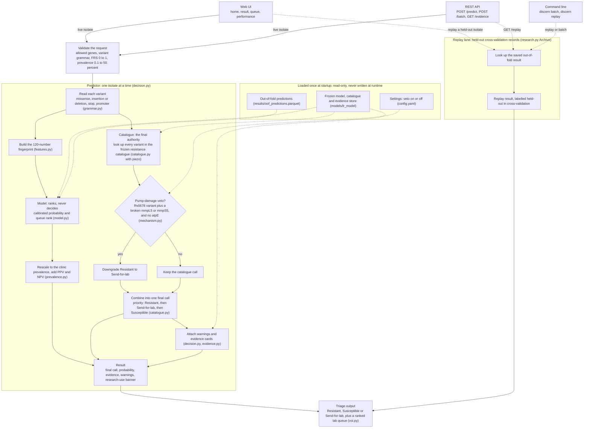

<p align="center">
  
</p>

<h1 align="center">Discern</h1>

<p align="center">
  Reads bedaquiline resistance in <em>Mycobacterium tuberculosis</em> from DNA variants.<br />
  A catalogue makes the call. A calibrated model ranks the uncertain ones. Nothing is guessed.
</p>

<p align="center">
  <a href="#what-it-does">What it does</a> &middot;
  <a href="#verified-numbers">Verified numbers</a> &middot;
  <a href="#architecture">Architecture</a> &middot;
  <a href="#how-it-works-component-by-component">Component walkthrough</a> &middot;
  <a href="#run-it">Run it</a> &middot;
  <a href="#what-it-cannot-do">What it cannot do</a>
</p>

---

> [!NOTE]
> **Research use only.** Discern is not a diagnostic device and does not recommend treatment. Every
> call it shows is a catalogue interpretation of sequence data. Real decisions still need phenotypic
> drug-susceptibility testing and a clinician, in line with national TB guidelines.

---

## What it does

Bedaquiline is the backbone of the modern all-oral TB regimens. Growing the bacterium in culture and
testing it directly (MGIT) gives a trustworthy answer, but it takes six to eight weeks. Sequencing is
far faster — the hard part is turning a list of DNA variants into a call you can act on. The cost of
being wrong is lopsided: label a harmless variant "resistant" and a patient is pulled off their best
drug onto a longer, more toxic regimen; label a real resistance "susceptible" and the regimen fails.

So Discern returns one of three things for an isolate, and it is deliberate about which:

- **Resistant** — a catalogue-documented resistance variant is present.
- **Susceptible** — only documented-benign variants or wild-type sequence.
- **Send for lab test** — the variants are novel, rare, low-frequency, or contradictory. Discern does
  not guess; it routes the isolate to culture and ranks the queue by how much a lab would learn from
  testing it.

Two rules hold everywhere in the system:

1. **The catalogue makes the final call.** The machine-learning model never overrides it. The model
   only produces a calibrated probability and a rank for the "send for lab test" pile.
2. **No guessing on novel variants.** If a variant is not in the evidence base, it is not called
   resistant — it is referred.

Discern runs entirely offline. There are no network calls at runtime, no telemetry, and request
payloads are never logged. It is built for an air-gapped reference lab or a district server.

---

## Verified numbers

Every figure below is read from the frozen result files under `results/`; the source is cited per row.
None of these numbers are typed by hand into the app or this document.

| What | Result | Source |
| :-- | :-- | :-- |
| Training data | 11,868 isolates, 866 resistant (CRyPTIC high-quality + NICD South Africa) | `results/approaches/data_prep/e01_prep` |
| Catalogue call, patient-grouped cross-validation | sensitivity **0.792**, specificity **0.984**, firm accuracy 0.944; refers 661 to lab (206 of them resistant) | `results/approaches/catalogue/e03_s1_catalogue_cv` |
| Model discrimination, patient-grouped cross-validation | AUC **0.909**, AUPRC 0.684, from 120 features | `results/models/lr_model/e04_s1_patient_cv` |
| External cohort (KM: 792 isolates, 35 resistant, never trained on) | catalogue sensitivity 0.792, specificity 0.988; model AUC 0.868 | `results/approaches/external_km/e_km_validation` |
| WHO v2 catalogue, same data, applied as-is | sensitivity 0.801, specificity 0.981 (at FRS &ge; 0.1) | `results/approaches/who_baseline/e02_who_as_is_frs0.1` |
| Acceptance gate | 14 / 14 pre-registered checks pass | `eval/verify.py` |
| Test suite | 98 tests pass | `pytest tests/` |

The model's AUC matches the catalogue; it does not beat it, and Discern does not claim to beat the WHO
catalogue. That is by design — the model is not here to out-call the catalogue. It is here to rank the
unresolved isolates and to put a calibrated probability next to each call.

What a call is worth depends on how common resistance is where you are using it. These are Bayes
estimates at an assumed prevalence, using the cross-validated catalogue sensitivity and specificity —
not guarantees:

| Resistance prevalence | Catalogue PPV | Catalogue NPV | Model PPV | Model NPV |
| :-- | :-- | :-- | :-- | :-- |
| 1% | 0.333 | 0.998 | 0.144 | 0.998 |
| 2% | 0.502 | 0.996 | 0.253 | 0.996 |
| 5% | 0.722 | 0.989 | 0.466 | 0.991 |
| 10% | 0.846 | 0.977 | 0.648 | 0.981 |

Read the top-left cell honestly: at 2% prevalence, roughly half of "resistant" calls are false alarms.
That is a property of low prevalence, not a defect in the model — and it is exactly why uncertain
isolates are referred to culture instead of being called. Source: `results/approaches/predictive_values/e13_ppv_npv`.

---

## Architecture

The diagram below is the runtime, drawn from the actual code. Solid arrows are the live prediction
path; dashed arrows are read-only loads at startup and the separate replay lane. The whole thing runs
in one process, offline.



The point of the picture: the **call** travels down the left of the engine (catalogue &rarr; veto &rarr;
aggregate), while the **probability** travels down the right (fingerprint &rarr; model &rarr; prevalence).
They meet only in the final result. The model can disagree with the catalogue — when it does, that is
surfaced as a `MODEL_DISAGREES` warning, never as a changed call.

---

## How it works, component by component

**`grammar.py` — read the variants.** Input is standard notation, `GENE@change` (for example
`Rv0678@141_ins_c`). Each change is classified as a missense substitution, an insertion or deletion, a
premature stop, a promoter change, synonymous, or uncallable. Synonymous and uncallable variants are
dropped before they reach the catalogue.

**`indel_canon.py` — make indels comparable.** Different aligners write the same insertion or deletion
at slightly different positions. This normalizes them to one convention so a variant matches the
catalogue entry instead of slipping through as "novel."

**`catalogue.py` — the final authority.** A frozen resistance catalogue (built with `catomatic`, queried
through `piezo`) returns Resistant, Susceptible, or Unresolved for each eligible variant in the core
loci *Rv0678*, *atpE*, and *pepQ*. `_aggregate` then collapses the per-variant calls into one call per
isolate: any Resistant makes the isolate Resistant, otherwise any Unresolved makes it Send-for-lab,
otherwise Susceptible.

**`mechanism.py` — the pump-damage veto.** *Rv0678* is only the repressor; the pump that actually pushes
bedaquiline out of the cell is MmpS5-MmpL5. If an isolate carries an *Rv0678* variant **and** a
high-confidence loss-of-function mutation in *mmpL5* or *mmpS5* **and** no *atpE* variant, the pump is
broken and the resistance mechanism cannot work. The veto downgrades that call from Resistant to
Send-for-lab (it never downgrades to Susceptible, and never touches an *atpE*-driven call). On the
cross-validation cohort it moved 41 calls: 39 were truly susceptible (false alarms removed) and 2 were
truly resistant (now referred to the lab rather than called resistant). Firm specificity rose from
0.984 to 0.987; firm sensitivity changed by &minus;0.0006, inside the pre-registered 0.005 margin. On
the external KM cohort the veto fired on zero isolates, so KM gives no direct evidence about it.
Source: `results/models/lr_mechanism/e16_lof_ablation`.

**`features.py` and `model.py` — the ranking model.** Each isolate becomes a 120-number fingerprint: a
vocabulary of variants seen in at least three training isolates, plus gene-level flags (missense,
DNA-binding-region missense, indel, stop, promoter, *atpE*, *pepQ*, *mmpL5* loss-of-function) and one
interaction term for *Rv0678* together with *mmpL5* loss-of-function. An L2 logistic regression
(C = 0.3) is fitted without resampling or class weighting, so its probabilities stay honest, and a
Platt calibrator is fitted on out-of-fold scores. The output is a calibrated probability and a rank —
nothing more.

**`prevalence.py` — match the probability to the clinic.** The training cohort is resistance-rich
(7.3% resistant, and far higher in the South African referral data). A real clinic may sit at 2–5%.
Discern rescales the probability by Bayes odds from the training prevalence to the prevalence you enter,
and derives PPV and NPV from the cross-validated catalogue sensitivity and specificity. This is the
whole reason the prevalence slider exists.

**`evidence.py` — show the working.** For each variant, an evidence card reports how many isolates carry
it, how many of those were resistant, a Wilson 95% interval, and a per-source split (CRyPTIC vs NICD),
with a note that NICD is enriched for resistance. A variant with no card is flagged novel.

**`decision.py` — the orchestrator.** `Predictor` loads the frozen artefacts once at startup and, per
isolate, runs the flow in the diagram and assembles the response: the call, the probability, the
evidence, the warnings, the versions, and the research-use banner.

**`voi.py` — rank the lab queue.** Unresolved isolates are ordered by how much a lab would learn from
culturing them (carrier count times expected information gain), so limited culture slots go to the
isolates that resolve the most uncertainty. In simulation, culturing the top 10 variant sets resolved
about 38% of referrals. Source: `results/approaches/voi_queue`.

**`conformal.py` — honest certificates.** Risk-controlled thresholds certify the resistant zone (the
achieved error stays under the target bound). The susceptible zone does **not** certify at the
pre-registered target, so Discern does not offer a distribution-free "safe to call susceptible"
guarantee, and the certificates are known to break under a shift in lab assay. This is reported, not
hidden. Source: `results/approaches/conformal`.

**`research.py` — the replay lane.** A read-only archive of held-out cross-validation records. The
replay pages and the `discern replay` command show the **out-of-fold** call and probability for an
isolate the production model has already seen, clearly labelled "held-out in cross-validation" so it is
never mistaken for a live prediction.

**`api/app.py`, `api/schemas.py`, `cli.py`, `ui/templates/` — the surfaces.** A FastAPI app serves the
JSON API and the server-rendered pages; Pydantic validates every request (gene whitelist, grammar-checked
variant notation, bounded FRS and prevalence, free text rejected). The CLI replays and batches recorded
isolates and runs the evaluation and verification pipelines. The web UI is plain Jinja with local CSS —
no external CDN, no external fonts.

**`structure.py` — Rv0678 positions.** Supplies codon positions and DNA-binding-region flags for the
variant table in the UI. A separate biophysical extension (Grantham distance, recognition-helix,
helix-breaker features) exists but is **exploratory only** — it is evaluated on a small subset in
`eval/e08_novel_variant.py` and is **not** part of the production model. It is not presented as an
improvement.

---

## Run it

Discern needs Python 3.12 (the `discern` conda environment) and the pinned dependencies in
`requirements.txt`. Install once so the `discern` command and the `discern.*` imports resolve:

```bash
pip install -e .
```

**Web app** (dashboard at `http://127.0.0.1:8000`):

```bash
make app
# or directly:
uvicorn discern.api.app:app --port 8000
```

**Command line:**

```bash
discern replay --sample-id <held-out-id>     # show a saved out-of-fold result
discern batch in.csv out.csv                 # rank a CSV of recorded isolates
discern eval --all                           # run the evaluation pipeline
discern verify                               # run the acceptance checks
```

**REST API** (offline, no auth, no request logging):

- `POST /predict` — one isolate; JSON body with `sample_id`, `prevalence`, and `variants[]`.
- `POST /batch` — a long-format CSV; returns per-isolate calls and a ranked queue for the unresolved ones.
- `GET /evidence/{gene}/{mutation}` — the evidence card for one variant.
- `GET /replay/{sample_id}` — a held-out out-of-fold record.
- `GET /health` — status plus the frozen model and data-manifest hashes.

The web UI adds `/result`, `/queue`, `/priority`, `/performance`, `/model-card`, and `/about`, plus
batch views for patient timelines and surveillance.

---

## What it cannot do

Stated plainly, because a triage tool that hides its limits is not trustworthy:

- **It cannot see resistance that is not in these genes.** About 16% of resistant isolates carry no
  variant in *Rv0678*, *atpE*, *pepQ*, *mmpL5*, or *mmpS5*. No method reading only these genes catches
  them, so the realistic sensitivity ceiling is around 84%. Discern refers these isolates; it does not
  claim to find them.
- **The external evidence is thin.** The KM cohort (792 isolates, 35 resistant) is a sensitivity analysis,
  not headline proof — its assay and critical concentration are undocumented, and it is the only external
  cohort tested so far.
- **Lineage 2 (Beijing) is the weak spot.** External sensitivity there was 0.643, against 1.000 for
  lineages 1 and 4.
- **No "safe susceptible" guarantee.** The conformal certificate covers the resistant zone but not the
  susceptible zone at the pre-registered target.
- **It does not beat the standard.** The model matches the catalogue and does not beat the WHO v2
  catalogue on ternary sensitivity. No "more accurate than WHO" claim is made or supported.
- **It is not a diagnostic**, has not been validated prospectively, and has not been validated in any
  specific country's patients.

---

## Reproduce and verify

```bash
make verify    # 14 pre-registered acceptance checks (recomputed from results/*.json)
make test      # the pytest suite (98 tests)
```

Or directly: `python eval/verify.py` and `pytest tests/ -q`. The verifier recomputes every tolerance
check from the saved observations and writes a failure report if anything drifts; if a check misses
tolerance, the rule is to stop and report it, not to tune the model until it passes.

---

## Documentation

- [Model card](docs/MODEL_CARD.md) — intended use, safety boundaries, evaluation, and limitations.
- [Results compendium](docs/RESULTS.md) — the tables behind every number above.
- [Glossary](docs/GLOSSARY.md) — the clinical-genomics terms used here.
- [Decisions and pre-registration](docs/DECISIONS.md) — what was locked before each experiment, and the
  no-tuning commitment.

---

## License and attribution

MIT License. Built for the Aditya Hackathon (Andhra Pradesh, India).

Discern builds on open data and cataloguing methods from the CRyPTIC consortium and the Fowler Lab, and
on the `catomatic` and `piezo` libraries. The external KM cohort comes from CRyPTIC v3.4.0
(Zenodo 15680920, CC-BY 4.0).

*Research use only. Not for clinical diagnostic use without independent laboratory confirmation.*
